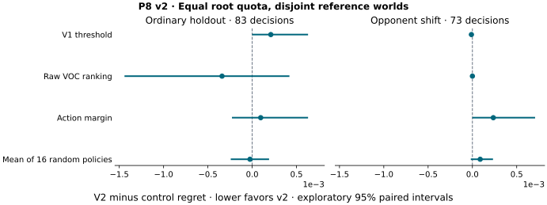

# Abstract

Fog of War Chess requires a player to choose moves from partial observations under tight per-player clocks. Our team developed a family of agents that track observation-consistent positions, use Stockfish to evaluate moves across those positions, and weight hypotheses by an opponent model. We used the frozen fourth version of that system as the reference for nine investigations into belief, information, tactical choice, and computation. Observation-consistent planning reduced regret on restricted referee fixtures, and information that distinguished the right follow-up move was valuable even when it revealed fewer squares. Those gains were difficult to turn into a better bot. In a real-engine replay audit, reserving one reply slot for an overlooked king threat changed the replies considered but changed none of 11 paired move choices. In the same six local games, threat-biased sampling estimated the retained belief more accurately, while prediction of realized threats did not improve. A larger holdout comparison likewise found no reliable benefit from the revised search allocator. No research variant qualified for full-clock confirmation. The experiments locate separate bottlenecks in belief, action selection, and search budget, and provide reproducible tests for evaluating future changes against the existing bot.

# 1. Introduction

In Fog of War Chess, a player knows where its own pieces are and sees only the portion of the board the referee reveals from its available moves. An unseen opponent piece may threaten a king or undefended piece. A move that looks safe on one plausible board can lose immediately on another. Even when the same move is safe on both boards, an engine that assumes it will see the opponent's next move may overvalue it. The player must prepare one response for each observation it could actually receive.

The project began with a scaled-down Obscuro-style search and progressed to a faster weighted-belief agent. Our research question was whether that reference could be improved by better inference about hidden boards, by planning over future observations, or by allocating a fixed search budget differently. We compared mechanisms under controls that held the rest of the decision process fixed where possible. We used toy cases to check correctness, referee-generated games for held-out measurements, and fresh local engine games to audit whether tactical opportunities occurred and influenced decisions. These evidence levels answer different questions. A counterexample can establish a planning error, while a paired full-clock comparison is needed to measure a bot's playing strength.

The central finding is that the route from a better model to a better move has several points of failure. Sampling can be more precise for a flawed retained belief. A broader reply search can discover a threat without changing the best root action. A scheduling rule can change how work is distributed without improving decisions on a disjoint reference. We use these separations to interpret the results and to explain the decision to retain frozen v4 as the reference.

# 2. Setting and course concepts

Let $s_t$ denote the hidden state at ply $t$. It includes the board position and the rules state relevant to future play, such as castling, en passant, and draw conditions. A player conditions on its own observation and action history $h_t$. A belief $b_t(s)$ assigns weight to states compatible with that history. The local referee determines legal moves and terminal outcomes. In particular, a king becoming capturable can terminate the game, and Fog of War castling follows the starter referee's movement rules rather than ordinary restrictions about attacked transit squares [1].

An idealized update after a hidden opponent action sums over each candidate previous state $s$ and opponent move $r$. With deterministic transition $T$ and observation $O$,
$$
b_{t+1}(s') propto
sum_{s,r} b_t(s),pi_{mathrm{opp}}(rmid s,h_t)
,mathbf{1}{T(s,r)=s'},mathbf{1}{O(s')=o_{t+1}}.
$$
This describes the role of an opponent likelihood and an observation filter. A practical implementation must bound the number of worlds, branch over plausible moves, and cope with model mismatch. If a compatible state was discarded, resampling the retained set cannot restore it. Work on particle planning and history filtering motivates these approximations and their limits [2, 3].

The second course connection is **strategy fusion** [4]. For a fixed root action $a$, let $L$ be a random continuation leaf after the opponent replies, let $O(L)$ be our next observation, and let $u(L,m)$ be the value of choosing move $m$ there. With a compatible feasible-action set for each observation, the value of a realizable one-step continuation is
$$
Q_{mathrm{obs}}(a)
= sum_o P(O=omid a)max_{min A(o)}
mathbb{E}[u(L,m)mid O=o,a].
$$
An evaluator allowed to choose a different move for every hidden leaf instead obtains an upper bound, $mathbb{E}[max_m u(L,m)mid a]$, when each feasible observation policy is also available to that evaluator. The difference measures the optimism introduced by having more information in the evaluator than the player will have. The team’s existing eBotI infoset search already uses a restricted two-ply correction based on this idea. Small games with exact security values also let us test when a mixed strategy can outperform a deterministic action. This connects to regret minimization and subgame solving, with stronger guarantees requiring additional assumptions about the larger game [5–8].

Finally, *value of computation* is different from value of an in-game observation [9]. It asks whether a search operation is worth its cost before the move is played. If an operation $c$ yields random search result $Y_c$ and updates estimated action values $widehat Q(amid Y_c)$, a simple criterion is
$$
mathbb{E}_{Y_c}left[max_a widehat Q(amid Y_c)
ight]
- max_a widehat Q(a) - lambda,mathrm{cost}(c).
$$
An apparent gain obtained by spending more time can disappear once the clock is matched. The final decision also needs a reserve against time forfeits.

# 3. Team system and reference bots

The original system included random and greedy bots, a local referee tournament runner, packaging, and tests. The first Obscuro-style agent used a belief set with a small subgame and predictive regret updates, using shallow material and visibility leaves. A later version used a deadline-aware Stockfish engine pool to score moves over candidate boards. The weighted version added a one-ply opponent likelihood and a native C++ position-set helper. The helper tracks the candidate set up to its configured cap and provides states and weights to the search. The Python path provides a fallback. The archived version records describe this evolution and report historical arena scores of about 39%, 45%, and 63% for frozen versions 2, 3, and 4, respectively. These runs occurred at different times against different arena mixes and provide descriptive context [10].

The team's later eBotI work investigated wider sampling, risk-sensitive aggregation, exact king risk, deeper tree search, hidden material hazards, an opening book, and clock allocation. It also studied replay patterns of the opponent Greek Gift. Historical tests documented an offline-to-online gap before our follow-up. A worst-board mixture reduced next-ply measures in saved data, while its reported score against frozen v3 was the same as v4's, 0.825, in the team's separate 80-game tests at 180+2. Adding a king-move penalty produced a reported score of 0.812. Those historical tests motivate separate decision and game metrics. They remain distinct from the later study [10].

We used three reference labels throughout. **B0** is the frozen `obscuro_v4` bot with Stockfish 19 and its native helper. **B2** is default eBotI. **B1** is an explicitly configured v4-like eBotI profile. On common prefixes, B1 matched B0 on 6 of 9 actions, while the B0 self-comparison agreed on 10 of 11. Shared components passed deterministic checks, but measured action agreement was insufficient to treat B1 as an interchangeable control. We kept B0 as the fixed reference for claims about improvement. In the short-clock pipeline checks at 36+0.4, B1 and B2 each scored 1–0–3 against B0 in separate four-game samples. A later two-game B2 smoke at 24+0.1 reached its 20-ply cap in both games. These runs established compatibility and did not supply strength estimates suitable for promotion [11].

# 4. Experimental design

## 4.1 Evidence and controls

The campaign used nine distinct questions. Each had a specified intervention, a control, and a primary measurement. First-version toy studies checked the expected mechanism or failure mode. For example, an information-set fixture checked the constraint of choosing one continuation per future observation, and a restricted game tested whether the solver recovered a known nonuniform mixed policy. We then screened the mechanisms on synthetic referee histories or bounded FoW fixtures. The P3 reply selector and P8 computation allocator received separate follow-up revisions, recorded on their own branches. The eligible set for full-clock confirmation was empty [11–13].

The canonical synthetic corpus contains 72 observation-only starter-policy games in 36 color-swapped blocks, with 2,190 predecision records. Whole games and their color-swapped partners were assigned together. Training, development, ordinary holdout, and opponent-shift splits contained 36, 12, 12, and 12 games respectively. We reconstructed all replays with the local referee and verified the observation and rules checks. The online feature record contains side, view, own-history hash, legal attempts, visible enemy count, and visible square count. Hidden boards, chosen actions, and policy identities are separated for retrospective analysis. These games have no measured chess clock. The P8 revision regenerated four new seeded corpora and used only the two holdout splits for its comparisons [11, 13].

The post-campaign follow-up collected six fresh B2-versus-B0 games at 24+0.1 with a 100-ply cap and three paired seeds. Both bots used their pinned native components. Five games ended with a capturable king and one reached the cap. Default eBotI scored 3–1–2. The opt-in hidden-reply rule was off for collection. We replayed each side's observations and own actions using the native helper with a 4,096-state cap and no opponent-policy weighting. We reconstructed real hidden boards only for retrospective labels and replay validation. This yields a local, game-derived test distribution with a specific pair of bots [14].

## 4.2 Measurements

For an event with label $yin{0,1}$ and forecast $p$, we use Brier loss $(p-y)^2$. For a recorded opponent action, negative log likelihood is $-log pi(a)$ [15]. P1 also measures error against an exact weighted average over the *retained support*. P1 draws from a mixture of the baseline weight distribution and a threat-biased proposal, then reweights each sampled world by the ratio of baseline to proposal probability. This evaluates the estimator conditional on that support. It differs from Brier error against the actual game event, which depends on the quality of the support and weights as well.

Action regret is the reference value of the best candidate minus the reference value of the selected candidate, on the same candidate set. A reference can be exact within a restricted domain or a deeper, truncated engine calculation. We identify which in each result. Prediction losses, action regret, restricted security utility and certificate soundness have different units. They are not pooled. For game comparisons the independent units are games or paired color/seed blocks. We do not treat plies, state samples, or mirrored boards as independent games. P8 intervals are exploratory paired bootstrap ranges. For the six-game follow-up we report descriptive differences and event counts.

# 5. Results

## 5.1 Belief, opponent prediction, and tactical risk

**Belief sampling (P1).** The first replay screen retained the true board at all 108 scored decisions, but contained zero positive hidden king-attack events and zero nonzero risk estimates. Forty player histories hit the support limit. This made that screen uninformative for calibration. In the six-game follow-up, the scheduled sample again missed all four positive labels, which motivated an exploratory all-plies audit. Across 428 compatible decisions, 39 had nonzero retained-support risk. We compared 64 ordinary draws and 64 threat-biased importance-weighted draws, using eight fixed seeds for each estimate. Mean squared error against the retained-support expectation decreased from $8.91	imes10^{-5}$ to $4.81	imes10^{-5}$. Brier loss against actual labels rose slightly from 0.006791 to 0.006906. This separates estimator variance from posterior quality. The proposal used an attack indicator computed across the retained support, so this trial also offers no estimate of net compute savings [12, 14].

**Opponent prediction (P2).** We updated a latent style mixture using observable event classes. Across 129 early replay decisions, the adaptive model's average action log loss was 3.480 versus 3.937 for the one-ply Stockfish control on ordinary holdout, and 3.440 versus 3.967 on policy shift. The adaptive model was slightly worse than the static mixture in-family. Its shifted action-loss difference from static was about −0.0023, with a paired interval crossing zero. The engine contrast shows that a different predictive model can fit the synthetic opponents better. The static control limits the claim about learning style online. We did not observe the kinds of opponents needed to establish general transfer [12].

**Unseen material losses (P5).** We compared a shrunk class-conditioned risk model with the training event rate. The label was an observed next-reply capture of an undefended knight, bishop, rook or queen by an unseen attacker. The main comparison used noncapture actions. Synthetic ordinary holdout Brier loss was 0.01760 versus 0.01762 for the constant, an uncertain contrast with six events. Under synthetic opponent shift it worsened to 0.00575 from 0.00572 with four events. On the six fresh local games the unchanged model had game-mean Brier loss of 0.004399 versus 0.003721 for the constant, with an adverse difference in all three pairs. Only one of 295 noncapture actions had the target event. We therefore retained the negative transfer observation as a diagnostic of this model and data, with limited evidence about the broader usefulness of risk prediction [12, 14].

## 5.2 What actually changes a tactical decision

**Observation-conditioned planning (P3).** In bounded referee fixtures, a policy that could respond to each future observation obtained zero mean regret, compared with 0.125 for a fixed blind continuation over eight restricted roots. The informative difference arose where hidden worlds required incompatible escapes. This demonstrated the mechanism in a deliberately small setting. The team's existing planner already groups continuations by observation. We tested a smaller intervention suitable for that code. We reserved at most one of its three reply slots for the highest-ranked omitted legal reply that creates an unseen king threat, provided the selected set already lacks such a threat. The opt-in scan preserves the legacy ranking when the slot is unused or the scan reaches its deadline.

On four paired fixture families, the new selector changed 18 of 32 root/world reply sets. The two arms chose the same root in all eight color-specific cases, with mean observation-consistent oracle regret of 0.03389 in both arms. To see whether the restricted fixtures had missed a useful effect, we repeated the comparison with real Stockfish tables on positions from the six fresh games. The fixed schedule offered 53 positions, of which 51 had compatible common engine tables. Seven of these had an omitted threat that changed at least one retained reply set. We scored the first exposed case and first ordinary eligible case per game with common roots, weights, candidate actions, and fixed-depth continuation tables. The deeper reference used up to eight ranked replies per world, with one continuation action per observed view and restricted Stockfish action lists. All 11 cases with matched complete leaf-table counts selected the same root, giving zero difference in reference regret. The legacy and opt-in leaf tables accounted for 790,743 and 774,148 Stockfish nodes. These counts measure shared offline work and leave full live clock equivalence unmeasured. The feature did find overlooked threats in actual game histories. On the tested cases those threats were insufficient to change the decision [12–14].

**Instrumental information value (P4).** A matched referee fixture held immediate utility and material fixed and used the same per-world escape utility table. One root let the player distinguish the relevant escape, giving information value 0.5, while another scored zero despite revealing more squares on average (10 versus 8.5). Both information bonuses were zero in the control where the same escape worked in either world. This tests the value of a future observation through the decision it enables. A count of revealed squares ranks the two roots in the opposite order. The test fixes the defender reply and does not establish an action-conditioned observation model for real opponents [12].

**Restricted strategic solving (P6).** In a referee-derived matrix where the adversary could select between hidden worlds with incompatible safe escapes, the mixed strategy improved worst-case utility from −1.0 for the greedy action to −0.5043. Its duality gap was about 0.0113. In the shared-safe-action control, mixing added no security gain. These are properties of the restricted matrix. Scaling the mechanism to playing search would require modeling opponent actions over multiple information sets, defining a suitable blueprint and leaf values, and comparing at the same engine budget [8, 12].

## 5.3 Continuation forecasts, computation and deployment coverage

**Learned continuation value (P7).** We fit a small regularized residual from observation-only features to improve a fixed sampled Stockfish evaluation of six-ply logged-action outcomes. In-family mean squared error rose from 0.05147 to 0.05232, and shifted error rose from 0.03548 to 0.04127. Both paired intervals included zero and the trained residual lost to simpler controls on both splits. Because the target describes the move that was taken, this evaluation cannot tell us which alternative action would have led to a better outcome. The results give no basis to deploy the tested residual. A fixed continuation policy and comparable labels for alternative actions would address a different, stronger question [12, 16].

**Adaptive computation (P8).** An initial eight-decision screen suggested a regret improvement from allocating one extra root adaptively. The reference in that screen reused some of the roots evaluated by the tested policies. We followed with new seeded corpora, disjoint evaluation and reference worlds within each decision, and the same optional-root quota for both arms. The v2 rule discounted the estimated value of another root if that estimate depended on one of the initial roots. We also included raw value-of-computation ranking, action-margin ranking, and seeded random allocations.

On the ordinary holdout, v2 regret was 0.00564945 versus 0.00543927 for v1. The paired difference was +0.00021017 with a 95% exploratory interval of [0, +0.00063052]. Of 24 blocks, 23 tied and one worsened. Both policies evaluated 351 roots, using 359,848 and 359,828 reported engine nodes, respectively. On opponent shift the paired difference was −0.00001124 with interval [−0.00003371, 0], with 23 ties and one improvement. For 16 of the 19 additional ordinary slots, the v2 ranking assigned a zero adjusted forecast. Giving the policy one more root would change the move on only 7 of 83 ordinary decisions. Held-out traces had repeated observation histories and actual node counts varied across paired blocks. These facts and the small observed differences support keeping the existing allocation as the control for this experiment [13].

{width=100%}

**Certified endgames (P9).** A separate one-turn solver checked whether a single common action could win across all candidate hidden worlds and the legal defender replies in a declared king-and-queen versus king domain. The local referee audit examined 222 active boards, 6,146 root actions and 39,034 defender replies. The oracle found 24 winning known-world positions, zero certifiable moves over the hidden-world groups, and zero false or missing certificates. No position in that material class occurred in the 428 playable plies of the six fresh games. The tested domain therefore gives a soundness check and a negative finding on coverage. It leaves longer-horizon guarantees open and is separate from published endgame results under their own rules and horizons [12, 14, 17].

# 6. Discussion and limitations

The most consequential result is the difference between improving an internal measurement and improving the move at the root. The belief experiment improved the accuracy of a Monte Carlo estimate without improving its score against game labels. The hidden-reply experiment expanded the considered tactical possibilities without changing a selected move. The computation experiment changed which decisions received extra work, while showing no ordinary held-out regret benefit at a matched root quota. Taken together, these results suggest that a future modification should identify the particular decision or error it can change before it is granted more of the clock.

The information fixtures still support an important design claim. How much a player learns depends on whether the next observation distinguishes consequential choices. This principle ties the partial-observation model to practical search design. A useful next experiment would select real positions with close competing actions, establish that the observation-conditioned value changes their ranking, and measure the cost at the point where the full bot commits to a move. The present extra-reply heuristic already had a direct opportunity to show that effect and selected the same move on every evaluated case. We therefore retain it as a documented experimental branch.

Several limitations bound the conclusions.

- **Data and prevalence.** The synthetic opponents were generated by simple policies, and the fresh local corpus covers only two bots and three color pairs. Hidden king events, noncapture material-loss labels, and certified endgames were sparse or absent. The sample does not represent competitive Elo or long-clock behavior.
- **Evaluation targets.** Several references enumerate the referee exactly only within their stated fixture domain. The game-derived P3 reference uses a deeper truncated Stockfish calculation on sampled hypothetical worlds. Its action values are finite-search proxies. Logged continuation outcomes do not identify what would have happened after a different move.
- **Budget matching.** Equal reply counts, root counts and nearly equal aggregate nodes control parts of the work. They leave wall time, engine process overhead, live clock allocation, and forfeit risk open.
- **Confirmation.** The short baseline runs served to validate the pipeline and collect histories. No research candidate met the condition for 180+2 confirmation. Historical arena records and teammate matches belong to earlier variants and settings and are reported separately.

# 7. Conclusion

The team built and froze a weighted-belief Stockfish agent that supplies a reproducible control for Fog of War research. We found cases where observation-consistent planning, information that changes a continuation, and mixed play make a measurable difference. We also found that the tested paths to deployment were weaker than their component-level results. The extra reply did not change decisions on the tested fixtures or real-engine replay positions, and the revised search allocator and learned residual failed to improve their ordinary holdouts. The evidence supports retaining v4 as the reference. A future candidate should isolate the change, demonstrate an effect on choices over independent observation histories, and measure that effect at a matched clock against the frozen bot.

# Reproducibility and data availability

The repository records the reference source and frozen-bot inventory, engine and network digests, run configurations, seed blocks, and checksummed archives. The report package contains an 18-catalog canonical results ledger, nine project closure notes, and the P8 figure with its interval data and generation code. The game-derived supplement adds the six complete replays and two source-pinned analysis passes. The archives used for the Stage 4 and Stage 5 comparisons and the follow-up were directly reverified. Earlier hosted verification records and exact source catalogs are preserved. Direct access to the older draft Release assets remains unavailable from the analysis environment. The follow-up regression suite passed 31 targeted protocol, frozen-bot, and replay tests with Stockfish enabled [11–14].

# AI-use disclosure

The human project team selected the Fog of War problem, developed the earlier bot family, and established the initial project context. For the later campaign, a human project member directed the objectives, authorized each research stage and the follow-up, and set the report scope. Generative AI assistance was substantial in organizing the hypotheses, writing the new prototype and analysis code, proposing and implementing the controls, running the test harnesses and experiments, interpreting outcomes, verifying archived evidence, producing the figure and results tables, and drafting this manuscript. The later archive records distinguish experimental additions from the existing team bot and third-party code. The experimental results are sourced to run manifests and saved outputs. [Workflow and AI-use record](https://github.com/smhgeo422/fog-of-war-chess-bots/blob/fa57975/research/contributions.md)

# References

1. MIT 6.7980 course staff. *Fog of War Chess Challenge* and starter referee. [Challenge](https://www.mit.edu/~6.7980/fow/) · [Starter protocol](https://github.com/smhgeo422/fog-of-war-chess-bots/blob/fa57975/starter/README.md).
2. Silver, D., and Veness, J. (2010). *Monte-Carlo Planning in Large POMDPs*. NeurIPS. [Proceedings](https://proceedings.neurips.cc/paper/2010/hash/edfbe1afcf9246bb0d40eb4d8027d90f-Abstract.html).
3. Solinas, S., Rebstock, C., Sturtevant, N., and Buro, M. (2023). History filtering in imperfect-information games. [NeurIPS record](https://proceedings.neurips.cc/paper_files/paper/2023/hash/87ee1bbac4635e7c948f3eea83c1f262-Abstract-Conference.html).
4. Cowling, P. I., Powley, E. J., and Whitehouse, D. (2012). *Information Set Monte Carlo Tree Search*. IEEE Transactions on Computational Intelligence and AI in Games. [Author manuscript](https://eprints.whiterose.ac.uk/id/eprint/75048/).
5. Zhang and Sandholm (2026). Obscuro. [ICLR paper](https://proceedings.iclr.cc/paper_files/paper/2026/hash/9705eec26e511d7844a591ce10c33a3f-Abstract-Conference.html).
6. Farina, G., Kroer, C., and Sandholm, T. (2021). Predictive Blackwell approachability. [AAAI record](https://mlanthology.org/aaai/2021/farina2021aaai-faster/).
7. Zhang and Sandholm (2021). Knowledge-limited subgame solving. [NeurIPS record](https://proceedings.neurips.cc/paper/2021/hash/c96c08f8bb7960e11a1239352a479053-Abstract.html).
8. Brown, N., and Sandholm, T. (2017). *Safe and Nested Subgame Solving for Imperfect-Information Games*. [NeurIPS](https://papers.nips.cc/paper_files/paper/2017/hash/7fe1f8abaad094e0b5cb1b01d712f708-Abstract.html).
9. Hay, N., Russell, S., Tolpin, D., and Shimony, S. E. (2012). *Selecting Computations: Theory and Applications*. [PMLR](https://proceedings.mlr.press/r10/hay12a.html).
10. Project team. Frozen bot versions and historical experimental notes. [Version history](https://github.com/smhgeo422/fog-of-war-chess-bots/blob/5806189/docs/versions.md) · [Earlier experiments](https://github.com/smhgeo422/fog-of-war-chess-bots/blob/5806189/APPROACHES.md).
11. Project repository. Baseline, methods and evidence ledger. [Stage 2](https://github.com/smhgeo422/fog-of-war-chess-bots/blob/260a684/research/STAGE2_FINDINGS.md) · [Report package](https://github.com/smhgeo422/fog-of-war-chess-bots/blob/260a684/research/report_package/README.md).
12. Project repository. Toy and restricted FoW experiments. [Stage 3](https://github.com/smhgeo422/fog-of-war-chess-bots/blob/260a684/research/STAGE3_FINDINGS.md) · [Stage 4](https://github.com/smhgeo422/fog-of-war-chess-bots/blob/260a684/research/STAGE4_FINDINGS.md).
13. Project repository. Targeted v2 ablations and confirmation decision. [Stage 5](https://github.com/smhgeo422/fog-of-war-chess-bots/blob/260a684/research/STAGE5_FINDINGS.md) · [Stage 6](https://github.com/smhgeo422/fog-of-war-chess-bots/blob/260a684/research/STAGE6_FINDINGS.md).
14. Project repository. Game-derived replay follow-up and run archives. [Findings](https://github.com/smhgeo422/fog-of-war-chess-bots/blob/fa57975/research/report_package/FOLLOWUP_FINDINGS.md) · [Run record](https://github.com/smhgeo422/fog-of-war-chess-bots/blob/fa57975/research/runs/followup-game-audit.json).
15. Gneiting, T., and Raftery, A. E. (2007). *Strictly Proper Scoring Rules, Prediction, and Estimation*. [JASA](https://doi.org/10.1198/016214506000001437).
16. Brown et al. (2020), ReBeL. [NeurIPS](https://papers.nips.cc/paper/2020/hash/c61f571dbd2fb949d3fe5ae1608dd48b-Abstract.html) · Schmid et al. (2023), *Student of Games*. [Science Advances](https://doi.org/10.1126/sciadv.adg3256).
17. Gehnen and Stannat (2026). Fog of War Chess endgames. [FUN](https://doi.org/10.4230/LIPIcs.FUN.2026.21).
